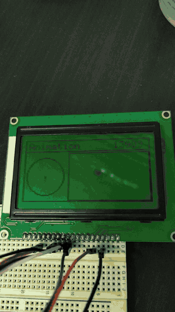

# st7920_i2c_glcd

A small, portable C driver for **ST7920 128×64 graphic LCDs** connected through a
**PCF8574 / PCF8574A / PCA8574 I2C I/O expander** (4-bit parallel mode).

Only two I2C wires go to the display, which leaves your MCU's pins free. The library contains no
MCU-specific code. You connect it to your own I2C driver and delay functions in a single config
header, so it works with any PIC (XC8) and with other MCUs and compilers that support C99.

## Demo

<p align="center">
  
</p>

<p align="center">
  The <a href="examples/pic16f1779_curiosity_hpc">PIC16F1779 example</a> running over I2C at 400 kHz
  (<a href="docs/demo.mp4">MP4 version</a>)
</p>

## Features

- **Text mode**: the ST7920's built-in 8×16 font, 4 lines × 16 characters, with no frame buffer
  needed.
- **Graphics mode**: a 1 KB frame buffer with pixels, lines, rectangles, circles, filled
  shapes, bitmaps and a 5×7 font that can be placed at any pixel.
- **Draw, erase or invert** colour modes, which are handy for animation.
- **Partial updates**: `glcd_update()` sends only the 16-pixel blocks that changed, so
  animations stay smooth even over I2C.
- **Any expander pin mapping**, plus optional reset and backlight pins.
- **Text-only build** for small MCUs: about 400 words of flash and about 20 bytes of RAM.

## Hardware

```
 MCU            PCF8574 / PCA8574            ST7920 128x64
 SDA  ───────── SDA                 P0 ───── RS   (pin 4)
 SCL  ───────── SCL                 P1 ───── E    (pin 6)
                                    P2 ───── RST  (pin 17)
                                    P3 ───── DB4  (pin 11)
                                    P4 ───── DB5  (pin 12)
                                    P5 ───── DB6  (pin 13)
                                    P6 ───── DB7  (pin 14)
                                    P7       (free: backlight switch, or unused)

 ST7920:  R/W (pin 5) → GND      PSB (pin 15) → VCC (parallel mode)
          DB0..DB3 not connected  VO / contrast pot as per your module
```

This is the default mapping in `config/st7920_glcd_config.h`, and every pin can be changed there.
I2C needs pull-up resistors on SDA and SCL. Many expander boards include them; if yours doesn't,
add 4.7 kΩ to VCC. Most ST7920 modules need **5 V**.

## Quick start (MPLAB X / XC8)

1. Copy `src/st7920_glcd.c`, `src/st7920_glcd.h` and `src/st7920_font5x7.h` into your
   project folder.
2. Copy `config/st7920_glcd_config.h` into your project folder and edit it. Set the I2C
   address, the pin mapping and the 5 port macros described below.
3. In MPLAB, right-click **Source Files → Add Existing Item…** and add `st7920_glcd.c`.
4. Use it:

```c
#include "st7920_glcd.h"

i2c_init();                     // your I2C driver
glcd_init();

// text mode
glcd_set_cursor(0, 0);
glcd_puts("Hello World");

// graphics mode
glcd_gfx_begin();
glcd_fb_clear();
glcd_rect(0, 0, 128, 64);
glcd_text(31, 3, "Hello World");
glcd_fill_circle(64, 40, 12);
glcd_update();
```

There is a complete working example (an animation with a radar sweep, a bouncing ball and a frame
counter) in [`examples/pic16f1779_curiosity_hpc`](examples/pic16f1779_curiosity_hpc).

## Porting: the 5 macros

In `st7920_glcd_config.h`:

| Macro | Must do |
|---|---|
| `GLCD_I2C_START()` | Send an I2C START condition |
| `GLCD_I2C_WRITE(b)` | Send one byte. The ACK result is ignored |
| `GLCD_I2C_STOP()` | Send an I2C STOP condition |
| `GLCD_DELAY_US(n)` | Busy-wait `n` µs |
| `GLCD_DELAY_MS(n)` | Busy-wait `n` ms |

The library only ever passes compile-time constants to the delay macros, so XC8's
`__delay_us()` / `__delay_ms()` work directly once `_XTAL_FREQ` is defined. On other
platforms, point them at your own delay functions.

The example's `i2c.c` is a polled MSSP master driver for PIC16F1xxx parts with PPS. On other
PICs you can use an MCC-generated I2C driver, or adapt the register names.

## API

### Text mode
| Function | Description |
|---|---|
| `glcd_init()` | Reset and initialise the display. Call it after your I2C init |
| `glcd_clear()` | Clear the text layer |
| `glcd_set_cursor(col, row)` | `col` 0–15, rounded down to even (the ST7920 stores 2 chars per address); `row` 0–3 |
| `glcd_putc(c)` / `glcd_puts(s)` | Write text at the cursor |
| `glcd_backlight(on)` | Only exists when `GLCD_PIN_BL` ≥ 0 |

### Graphics mode (`GLCD_USE_GRAPHICS 1`)
| Function | Description |
|---|---|
| `glcd_gfx_begin()` / `glcd_gfx_end()` | Switch between graphics and text mode |
| `glcd_fb_clear()` | Clear the frame buffer |
| `glcd_update()` | Send only the changed areas to the display |
| `glcd_update_all()` | Force a full refresh |
| `glcd_color(c)` | `GLCD_COLOR_ON`, `GLCD_COLOR_OFF` or `GLCD_COLOR_INVERT`, for all following shapes |
| `glcd_pixel(x, y, c)`, `glcd_get_pixel(x, y)` | Set or read one pixel |
| `glcd_hline`, `glcd_vline`, `glcd_line` | Lines |
| `glcd_rect`, `glcd_fill_rect` | Rectangles (x, y, width, height) |
| `glcd_circle`, `glcd_fill_circle` | Circles (centre, radius) |
| `glcd_bitmap(x, y, w, h, data)` | Monochrome bitmap: rows top to bottom, MSB = leftmost pixel, set bits drawn |
| `glcd_char`, `glcd_text` | 5×7 font in a 6×8 cell (`GLCD_USE_FONT5X7 1`) |

Coordinates go from (0, 0) at the top left to (127, 63). Shapes are clipped at the screen edges.

### Animation pattern
```c
glcd_color(GLCD_COLOR_OFF);  glcd_fill_circle(x, y, 4);   // erase old
x += vx;                                                  // move
glcd_color(GLCD_COLOR_ON);   glcd_fill_circle(x, y, 4);   // draw new
glcd_update();                                            // send only what changed
```

## Resources

Measured with XC8 v1.45 (free mode) on a PIC16F1779:

| Build | Flash | RAM |
|---|---|---|
| Text mode only | ~400 words | ~20 bytes |
| Graphics + 5×7 font (full example) | ~3.2 K words | ~1.2 KB |

Graphics needs an MCU with at least about 1.3 KB of RAM, such as a PIC16F1xxx with 2 KB or
most PIC18 parts.

**Speed:** each display byte takes 4 I2C bytes. A full-screen refresh takes about 0.4 s at
100 kHz and is roughly 4× faster at 400 kHz. Partial updates are much faster than that. A
genuine PCA8574 is rated for 400 kHz; a PCF8574 is rated for 100 kHz, although it often works
faster.

## Troubleshooting

- **Blank screen:** check that PSB is tied high and R/W to GND, then adjust the contrast pot.
- **Nothing at all:** check the I2C address (0x27 or 0x3F) and the pull-up resistors.
- **Garbage at 400 kHz:** go back to 100 kHz. The expander may not support the faster speed.
- **Text overlapping graphics:** the ST7920 text and graphics layers are shown on top of each
  other. `glcd_gfx_begin()` clears the text layer.

## License

MIT. See [LICENSE](LICENSE).
